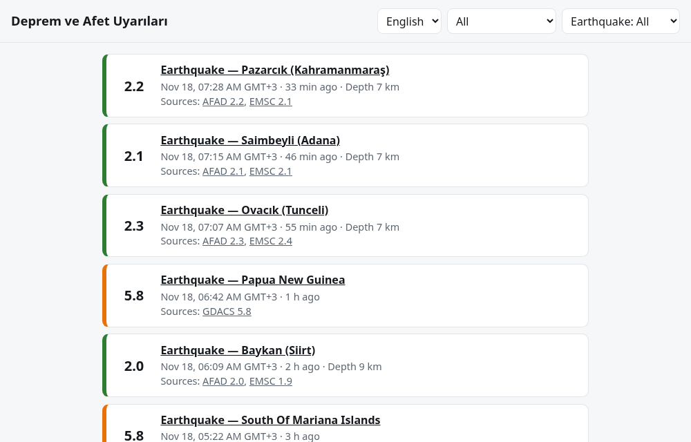
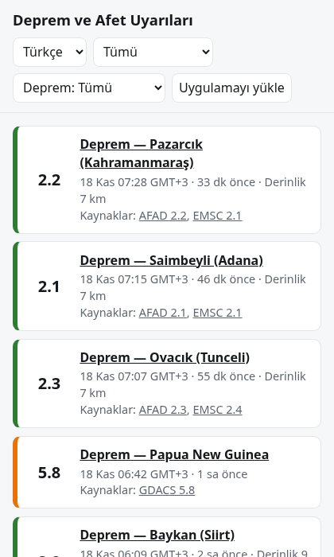

# alertpages

**A disaster alert relay you deploy by clicking "Use this template": GitHub Actions polls official earthquake and hazard feeds, publishes an offline-capable alert page on GitHub Pages, and pushes new alerts to Telegram. No server, no database, no dependencies.**

[Live demo (Türkiye preset)](https://tahakocpinar.github.io/alertpages/) · [Türkçe](#türkçe)



- **Sources:** AFAD, Kandilli (KOERI), EMSC, USGS, GDACS, any CAP 1.2 feed (MeteoAlarm, national weather services) and plain RSS/Atom.
- **One event, one message:** the same quake reported by AFAD, Kandilli and EMSC is merged into one alert that lists every agency's magnitude.
- **Telegram without a bot server:** messages are sent from the workflow; the token stays in a repository secret.
- **Offline PWA:** the page and the last alert list are cached by a service worker, so it still opens on a weak or dead connection. Installable on phones.
- **Multilingual:** English, Türkçe, العربية (RTL) and Español; the page follows the browser language, `?lang=tr` forces one.
- **Also gives you** `alerts.json` (machine-readable), `feed.xml` (RSS with GeoRSS points) and a per-source health list.

> alertpages relays public feeds every few minutes. It is **not** an earthquake early-warning system and must not replace official alerts (e-Devlet/AFAD, cell broadcast, sirens).

## Why

Every earthquake in Türkiye shows up two or three times: AFAD, Kandilli and EMSC each publish it, with slightly different times, coordinates and magnitudes. Most Telegram bots and scrapers in this space relay a single agency, and the ones that combine sources run on a VPS that someone has to keep alive. Server-side alert hubs (CAP aggregators, public alert servers) are built for institutions, not for a neighbourhood group, a school or a newsroom that wants its own page.

alertpages runs entirely on free GitHub infrastructure, which keeps working when you forget about it.

### Measured on real data

AFAD, EMSC and Kandilli reports for Türkiye, 24 hours ending 2026-11-18 07:28 (UTC+3):

| | Raw reports | After merge |
|---|---:|---:|
| All magnitudes | 289 | 131 events |
| M ≥ 2.0 | 67 | 31 |
| M ≥ 4.0 (default Telegram threshold) | 3 | **1 message** |

64 events were reported by all three agencies, 30 by two. Merged reports were at most 8 s apart (median 1 s). Reproduce on live data with `python -m alertpages run --dry-run`, which prints `N reports -> M events`.

## Set up (5 minutes)

1. Click **Use this template → Create a new repository** (public, so Actions and Pages are free).
2. **Settings → Pages → Build and deployment → Source: GitHub Actions.**
3. **Actions → relay → Run workflow.** Your page is at `https://<user>.github.io/<repo>/` and refreshes every 5 minutes.
4. Optional, Telegram:
   - Create a bot with [@BotFather](https://t.me/BotFather), add it to your channel or group (as admin for channels).
   - **Settings → Secrets and variables → Actions:** add `TELEGRAM_BOT_TOKEN` and `TELEGRAM_CHAT_ID` (e.g. `@my_channel` or a numeric group id).

The first run only records what is already in the feeds; from then on, each new alert that matches your Telegram rule is sent once. Edit `alertpages.toml` to change sources, languages and thresholds; presets are in [`examples/`](examples/).

## Configuration

`alertpages.toml` (default preset: Türkiye):

```toml
[site]
title = "Deprem ve Afet Uyarıları"
languages = ["tr", "en", "ar"]        # first one, or default_language, is the default
timezone = "Europe/Istanbul"

[[sources]]
type = "afad"                          # afad | kandilli | emsc | usgs | gdacs | cap | rss
lookback_hours = 72

[[sources]]
type = "emsc"
bbox = [25.5, 35.5, 45.0, 42.5]        # min_lon, min_lat, max_lon, max_lat

[[sources]]
type = "cap"                           # any CAP 1.2 Atom feed or single CAP document
name = "meteoalarm"
kind = "weather"
url = "https://feeds.meteoalarm.org/feeds/meteoalarm-legacy-atom-greece"

[display]                              # what the page shows
max_age_hours = 72
min_magnitude = 2.0

[telegram]                             # what gets pushed
language = "tr"
min_magnitude = 4.0
min_severity = "severe"                # for non-earthquake alerts
max_age_hours = 6
regions = [{ name = "İstanbul", lat = 41.01, lon = 28.98, radius_km = 250 }]
max_messages_per_run = 10
```

Rules (`[display]`, `[telegram]`) accept `kinds`, `min_magnitude`, `min_severity`, `max_age_hours`, `bbox` and `regions` (circles; CAP alerts without geometry match on the region name). A GDACS Orange or Red impact alert passes even below `min_magnitude`, because a shallow M5.2 under a city matters more than the number suggests.

Merging (`[merge]`): reports from different sources within `window_seconds` (90), `distance_km` (100) and `magnitude_delta` (1.0) become one event. The first source in `prefer` supplies the title and link. Two reports from the same agency are never merged, so aftershock sequences stay intact.

## How it works

```
cron (every 5 min) ─► fetch feeds ─► normalize ─► merge duplicates ─► filter
                                                                      ├─► Telegram (new only)
                                                                      └─► _site/ ─► GitHub Pages
```

The "already sent" state is published with the site (`state.json`) and read back on the next run, so there are no commits, caches or databases. If the previous state cannot be fetched, only alerts from the last 30 minutes are relayed, which bounds duplicates without dropping a real event. A failing source is shown on the page and skipped; if every source fails, the previous deployment stays online.

## Run locally

Python 3.11+, standard library only.

```bash
git clone https://github.com/TahaKocpinar/alertpages && cd alertpages
python -m alertpages run --dry-run --out _site       # live feeds, prints Telegram messages
python -m http.server -d _site 8000                  # open http://localhost:8000
python -m unittest discover -s tests                 # 39 tests, offline fixtures
```

## Limitations

- Scheduled workflows run every 5 minutes at best and are often delayed by 5 to 15 minutes under load. Expect alerts a few minutes after the agency publishes them.
- GitHub disables scheduled workflows in repositories with no activity for 60 days; you get an email and can re-enable with one click.
- Kandilli's `lst0.asp` is frequently unreachable from outside Türkiye, including GitHub-hosted runners. AFAD and EMSC (which ingests KOERI data) cover the same events; a self-hosted runner in Türkiye fixes it.
- Magnitudes differ between agencies; all of them are shown rather than picking a "true" value.

## Data sources and attribution

| Source | Coverage | Terms |
|---|---|---|
| [AFAD](https://deprem.afad.gov.tr/) | Türkiye and surroundings | Public data of the AFAD Presidency |
| [Kandilli Observatory (KOERI)](http://www.koeri.boun.edu.tr/scripts/lst0.asp) | Türkiye and surroundings | Cite Boğaziçi University KOERI-RETMC |
| [EMSC](https://www.seismicportal.eu/) | Euro-Mediterranean, global | Credit EMSC |
| [USGS](https://earthquake.usgs.gov/earthquakes/feed/) | Global | Public domain |
| [GDACS](https://www.gdacs.org/) | Global multi-hazard | CC BY 4.0, © European Union |
| [MeteoAlarm](https://meteoalarm.org/) | European weather warnings | CC BY 4.0 equivalent, see their terms |

Your page links every alert back to its agency. Check each provider's terms before republishing at scale.

## Türkçe

**alertpages**, sunucu gerektirmeyen bir afet uyarı rölesidir. GitHub Actions her 5 dakikada bir AFAD, Kandilli, EMSC, USGS, GDACS ve CAP akışlarını okur; aynı depremi bildiren kurumların kayıtlarını tek olayda birleştirir, GitHub Pages'te çevrimdışı da açılan bir uyarı sayfası yayınlar ve yeni uyarıları Telegram kanalınıza gönderir.



Kurulum:

1. **Use this template → Create a new repository** (herkese açık).
2. **Settings → Pages → Source: GitHub Actions.**
3. **Actions → relay → Run workflow.** Sayfanız `https://<kullanıcı>.github.io/<repo>/` adresinde.
4. Telegram için: @BotFather ile bot oluşturun, kanala ekleyin, `TELEGRAM_BOT_TOKEN` ve `TELEGRAM_CHAT_ID` değerlerini **Settings → Secrets and variables → Actions** altına secret olarak girin.

Varsayılan ayar Türkiye içindir: sayfada M2.0 ve üstü, Telegram'da Türkiye sınırları içinde M4.0 ve üstü depremler ile GDACS Turuncu/Kırmızı uyarılar. Eşikleri, bölgeleri (ör. İstanbul çevresi 250 km) ve dilleri `alertpages.toml` dosyasından değiştirebilirsiniz.

Ölçüm: 18 Kasım 2026'ya kadar olan 24 saatte AFAD, EMSC ve Kandilli 289 kayıt yayınladı; birleştirme sonrası 131 olay kaldı. M4.0 ve üstü 3 kayıt tek bir Telegram mesajına indi.

<br clear="right">

**Önemli:** Bu proje erken uyarı sistemi değildir. GitHub'ın zamanlanmış işleri birkaç dakika gecikebilir. Resmî uyarıları ve AFAD talimatlarını esas alın.

## License

MIT. Feed data belongs to the respective agencies (see above).
